# SafeReady

**A disaster preparedness e-learning app for high school students, built natively for Android in Kotlin.**

SafeReady teaches students what to do before, during and after six hazards that matter in Malaysia: floods, fires, earthquakes, landslides, tsunamis and thunderstorms. Students learn from short illustrated lessons, practise with scenario-based exercises, pack a virtual Go-Bag, and watch a weighted preparedness score grow as they earn badges and a Safety Champion certificate. Everything works offline, which matters when a flood takes the network down.

**[⬇ Download the APK](https://github.com/Fayzirahmon/SafeReady/releases/latest)** (Android 7.0 or newer)

<p align="center">
  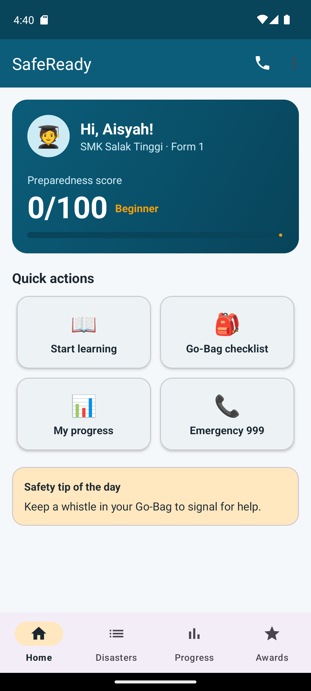
  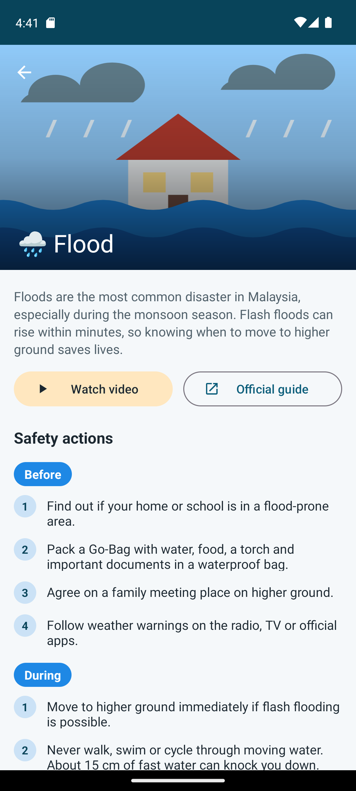
  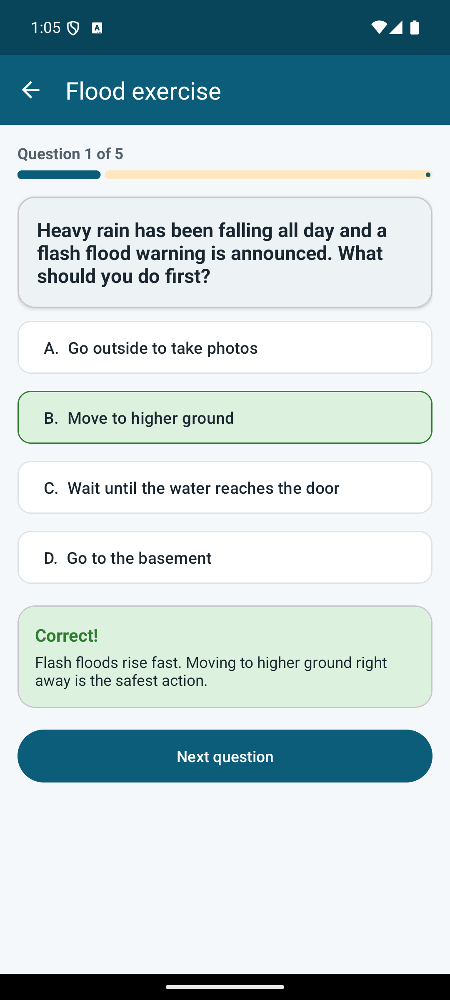
  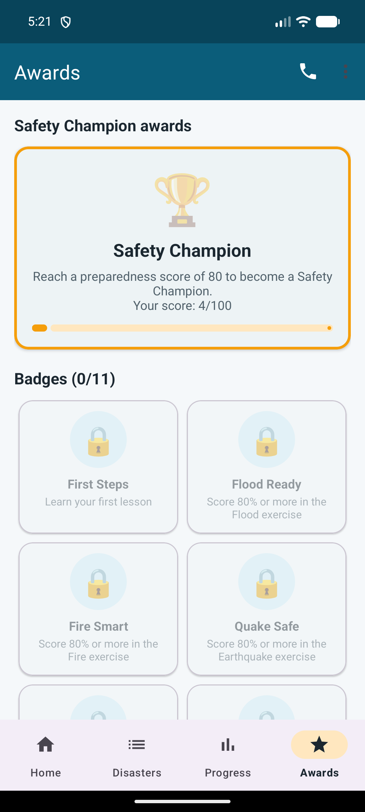
</p>

## Features

- **User profile:** name, school, class level and one of eight avatars, with input validation, saved on the device.
- **Six disaster categories:** a list with each hazard's best score, stars and lesson status.
- **Lessons:** an illustration in a collapsing app bar, 12 safety actions grouped under Before, During and After, a safety video and the official guide.
- **Interactive exercises:** 30 scenario questions (five per hazard) with instant feedback and an explanation for every answer. Progress survives screen rotation, and leaving mid-exercise asks for confirmation.
- **Go-Bag checklist:** 12 emergency kit items, each tick saved immediately.
- **Preparedness score:** a score out of 100 weighted 60% exercises, 20% lessons and 20% Go-Bag, with four levels, a per-disaster bar chart and advice on what to work on next.
- **Rewards:** stars per exercise, 11 unlockable badges and a shareable Safety Champion certificate at a score of 80.
- **Phone integration:** one-tap emergency dial (999), video and guide links, and sharing results through any app.
- **Polish:** spring animations and haptic feedback (skipped when the system turns animations off), Material fade-through tab transitions and a dark theme.

## Screenshots

| Splash | Profile | Disasters | Wrong answer |
|:-:|:-:|:-:|:-:|
| 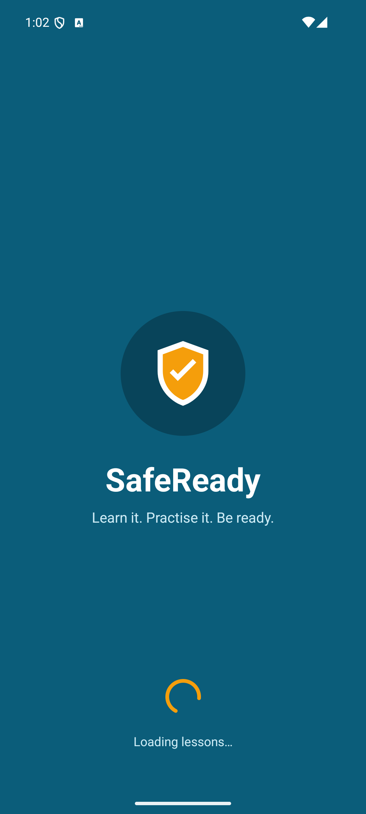 | 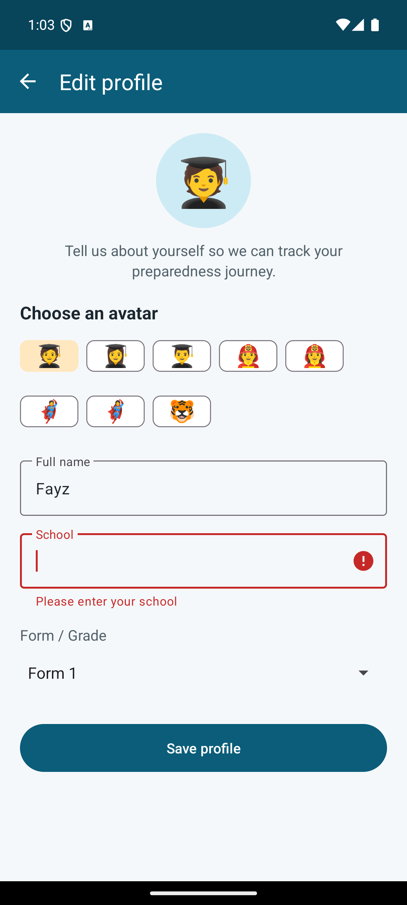 | 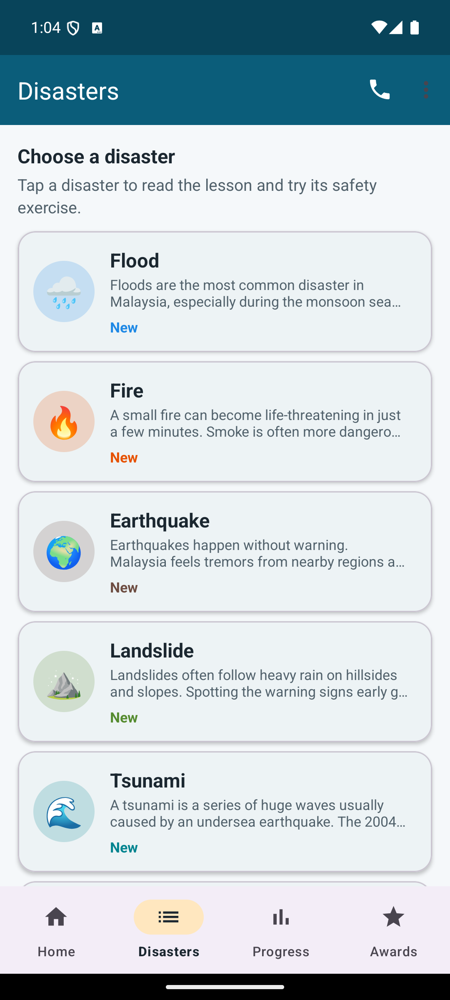 | 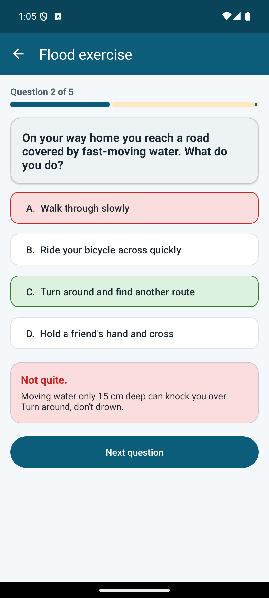 |
| **Result** | **Progress** | **Go-Bag checklist** | **Options menu** |
| 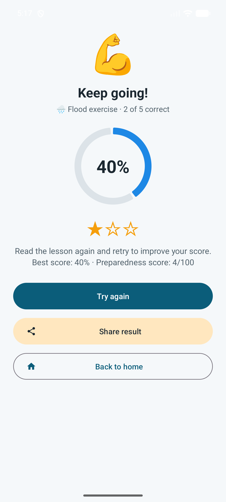 | 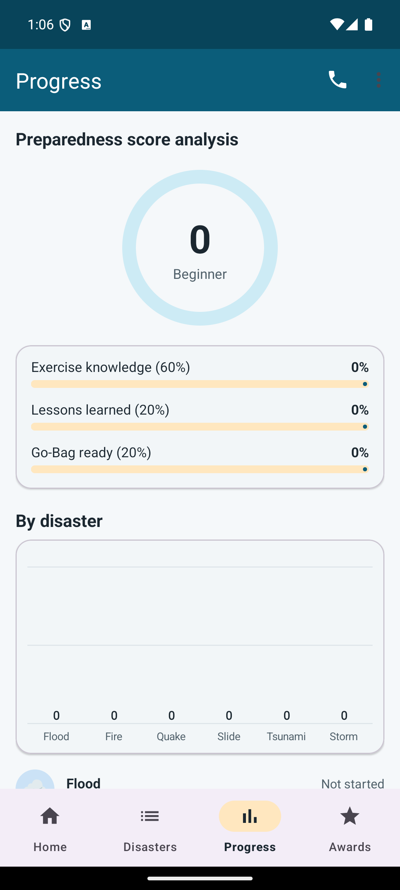 | 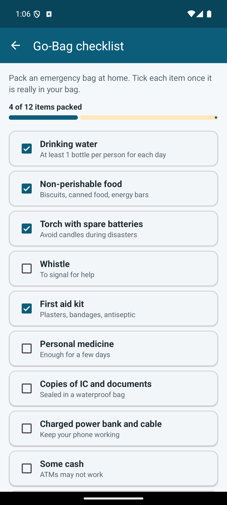 | 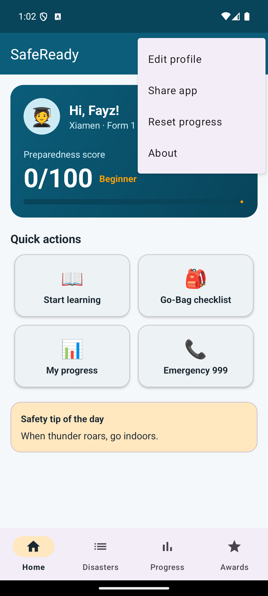 |

## Tech stack

| Area | Used |
|---|---|
| Language | Kotlin 2.2, Java 17 target |
| Platform | Android SDK 24 to 35 (Android 7.0 and newer) |
| Build | Gradle 9.3 with the Android Gradle Plugin 9.1 |
| UI | XML layouts, Material Components, ConstraintLayout, CoordinatorLayout with CollapsingToolbarLayout, RecyclerView |
| Navigation | Seven activities, four fragments behind a bottom navigation bar, explicit and implicit intents |
| Storage | SharedPreferences |
| Graphics and motion | A custom Canvas view (bar chart), AndroidX DynamicAnimation springs, haptics |

## Architecture

```
com.swe401.safeready
├── ui/            one activity per screen, plus helpers
│   ├── fragments/ Home, Disasters, Progress and Awards tabs
│   ├── ImplicitIntents.kt   dial, view and share intents
│   ├── Motion.kt            springs, count-ups and haptics
│   └── BarChartView.kt      custom-drawn progress chart
├── adapters/      five RecyclerView adapters (one with two view types)
└── data/
    ├── ContentRepository.kt lessons, questions, kit items and tips
    ├── ProgressStore.kt     profile and progress in SharedPreferences
    ├── ScoreCalculator.kt   pure scoring rules (no Android classes)
    └── Models.kt            data classes
```

The content, the saved progress and the scoring rules are kept apart from the screens. That means moving progress to a database or the cloud would only change `ProgressStore`.

## Build and run

1. Clone the repository and open the folder in Android Studio.
2. Let Gradle sync.
3. Run on an emulator or a phone with Android 7.0 or newer.

To build an APK from the command line:

```bash
./gradlew assembleDebug
# output: app/build/outputs/apk/debug/app-debug.apk
```

## Content sources

The safety actions are based on FEMA's *Be a Hero!* youth preparedness curriculum for grades 9 to 12 (Ready.gov). In a real emergency, always follow the instructions of local authorities.
